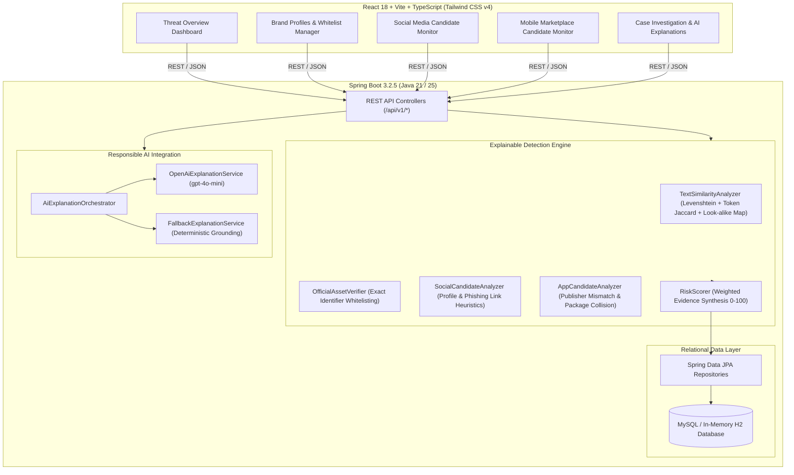

# BrandShield AI — Digital Risk Protection Platform
## Hackathon Edition • Full-Stack Cybersecurity Solution

**BrandShield AI** is an explainable prototype for reviewing potential brand impersonation in imported social profiles and mobile app listings. It stores brand assets, scores candidate records, and supports analyst investigations. Social-platform and app-store discovery connectors are not included; candidates are added manually or loaded as synthetic demo data.

---

## 🏛 System Architecture



## Analyst-facing additions

- **Exposure Pulse** summarizes current critical and unreviewed cases plus social/app detection counts. Its restrained 3D tilt is based on the 21st.dev 3D tilt-card pattern and disables motion when the system requests reduced motion.
- **Evidence Pack Export** downloads a case as JSON with its signals, notes, status history, candidate metadata, and AI explanation for analyst handoff.

---

## 🔬 Core Detection Algorithms & Methodology

### 1. Name Similarity & Look-Alike Analysis (`TextSimilarityAnalyzer`)
- **Unicode NFKD Normalization**: Decomposes accents, strips non-alphanumeric noise, and standardizes casing.
- **Levenshtein Distance**: Measures exact insertion, deletion, and substitution edits:
  $$\text{Normalized Similarity} = 1.0 - \frac{\text{editDistance}}{\max(\text{len}_1, \text{len}_2)}$$
- **Token Jaccard Similarity**: Evaluates word re-ordering for multi-token organization names.
- **Visual Look-Alike Character Matrix**: Flags deliberate character substitutions commonly used to deceive users:
  - `1` $\leftrightarrow$ `l` (e.g. `techvau1t` $\leftrightarrow$ `techvault`)
  - `0` $\leftrightarrow$ `o` (e.g. `g00gle` $\leftrightarrow$ `google`)
  - `3` $\leftrightarrow$ `e`, `4` $\leftrightarrow$ `a`, `5` $\leftrightarrow$ `s`, `@` $\leftrightarrow$ `a`, `!` $\leftrightarrow$ `i`
- **Affix Impersonation Heuristics**: Detects deceptive corporate suffixes and prefixes (`_support`, `_helpdesk`, `official_`, `_verify`).

### 2. Official Asset Whitelisting & Exclusion (`OfficialAssetVerifier`)
- **Security Rule**: Official brand assets are strictly verified via **exact immutable platform identifiers** (e.g., account ID, package bundle ID, canonical URL), **never by display name similarity**.
- **Exclusion**: Verified official assets are omitted from threat detections and counted in the scan result. Matching uses stable account/package identifiers or an exact canonical social URL.

### 3. Mobile App Vector Analysis (`AppCandidateAnalyzer`)
- **Package ID Proximity**: Flags applications whose package names mimic official ones without matching exactly (e.g. `com.techvauit.app` vs `com.techvault.app`).
- **Publisher Mismatch**: Detects third-party publishers distributing apps claiming the brand's trademarks.
- **Suspicious Redirects**: Flags external distribution links hosted on link shorteners or suspicious TLDs (`.tk`, `.ml`, `bit.ly`).

---

## 📊 Explainable Risk Scoring Methodology

Rather than a black-box probability, BrandShield AI calculates an **investigative priority score (0–100)** where every single point is backed by an auditable signal.

| Category | Base Weight | Rationale |
| :--- | :---: | :--- |
| **IDENTIFIER_CONFLICT** | `1.5x` | Conflicting package ID or account ID is the strongest indicator of deliberate spoofing. |
| **PUBLISHER_MISMATCH** | `1.3x` | Rogue developers releasing apps under brand trademarks in official stores. |
| **CHARACTER_SUBSTITUTION** | `1.2x` | Look-alike characters (`1` for `l`) signal malicious intent rather than coincidence. |
| **SUSPICIOUS_LINK** | `1.1x` | Profile bios containing URL shorteners or credential-harvesting patterns. |
| **IMAGE_SIMILARITY** | `1.1x` | Reserved scoring category; visual image comparison is not implemented in this prototype. |
| **NAME_SIMILARITY** | `1.0x` | Baseline edit-distance match against protected brand names and registered aliases. |
| **AFFIX_PATTERN** | `1.0x` | Impersonation affixes (`_support`, `_official`). |
| **DESCRIPTION_SIMILARITY**| `0.8x` | Keyword overlaps in bio descriptions. |
| **METADATA_ANOMALY** | `0.7x` | Low follower counts or missing profile verification. |

### Severity Thresholds:
- **0 – 25**: `LOW` (Likely benign or coincidental similarity)
- **26 – 50**: `MEDIUM` (Requires analyst monitoring)
- **51 – 75**: `HIGH` (Strong impersonation indicators)
- **76 – 100**: `CRITICAL` (Urgent active threat / potential credential harvesting)

---

## 🤖 Responsible AI Threat Intelligence

BrandShield AI features a multi-tiered **`AiExplanationOrchestrator`**:
1. **Google Gemini AI (Recommended • `gemini-3.8-flash`)**:
   - Native integration with Google Generative Language API.
   - Outputs structured threat intelligence schemas via `responseMimeType="application/json"`.
   - Activated automatically by setting the `GEMINI_API_KEY` environment variable.
2. **OpenAI Provider (`gpt-4o-mini`)**:
   - Secondary provider activated when `OPENAI_API_KEY` is supplied.
3. **Deterministic Fallback Engine**:
   - Zero-configuration engine that operates with zero downtime if no API key is configured.
   - Formulates explainable summaries, observed facts, and analyst recommendations directly from algorithmic signals.

---

## 🚀 Getting Started (Windows PowerShell)

### Prerequisites
- **Java 21+** (Java 21 or Java 25 LTS installed)
- **Node.js 18+** with `npm`

### 1. Configure Your Gemini API Key (Optional but Recommended)

The backend reads `GEMINI_API_KEY` from the project `.env` file automatically. Keep that file private; do not commit or paste the key into source files. The application tries Gemini first when generating an investigation explanation.

In your PowerShell window before starting:
```powershell
$env:GEMINI_API_KEY="AIzaSyYourGeminiApiKeyHere"
```
*(Or specify it directly when launching the JAR via `-Dapp.ai.gemini.api-key="your_key"`)*

### 2. Start the Backend API

```powershell
cd "s:\My Projects\DigitalRiskProtection\backend"

# Run the 25 automated JUnit tests
.\mvnw.cmd test

# Start the Spring Boot backend with your Gemini key and in-memory H2 database
java "-Dspring.profiles.active=dev" -jar target\brandshield-api-1.0.0.jar
```
*Backend runs at:* `http://localhost:8080`  
*Swagger API Documentation:* `http://localhost:8080/swagger-ui.html`

### 2. Start the Frontend Dashboard

```powershell
cd "s:\My Projects\DigitalRiskProtection\frontend"

# Launch development server
cmd.exe /c "npm run dev"
```
*Frontend runs at:* `http://localhost:5173`

---

## 🐳 Running with Docker

### 1. Build and Run the Unified Full-Stack Container (Recommended)

Builds both frontend and backend into a single Alpine container serving both UI and API:

```powershell
# Build image
docker build -t brandshield-ai .

# Run with Gemini API key
docker run -d -p 8080:8080 -e GEMINI_API_KEY="your_api_key_here" --name brandshield brandshield-ai
```
*Visit application:* `http://localhost:8080` (Frontend UI + REST APIs + Swagger)

### 2. Run with Docker Compose (with Persistent MySQL)

```powershell
# Set your Gemini key
$env:GEMINI_API_KEY="your_api_key_here"

# Start the full stack
docker compose up -d
```

---

## 🎬 Live Hackathon Demo Walkthrough Script

> This is a seeded-data demonstration. The scan processes candidate records already stored in the application; it does not query social networks or app stores.

| Step | Action | Endpoint / UI View | Expected Result |
| :---: | :--- | :--- | :--- |
| **1** | **Initialize Demo Data** | `POST /api/v1/demo/seed` (or click "Load Demo Data" on Overview) | Creates brand `TechVault` with 2 official assets (Twitter & Google Play), 4 social profiles, 3 app candidates. |
| **2** | **Verify Whitelist** | Navigate to **Brand Profiles** $\rightarrow$ `TechVault` | Shows the official account ID and package ID registered as verified whitelist assets. |
| **3** | **Run Social Scan** | Navigate to **Social Monitoring** $\rightarrow$ Click **"Run Social Scan"** | Analyzes all social candidates against brand and aliases. |
| **4** | **Run App Scan** | Navigate to **App Monitoring** $\rightarrow$ Click **"Run App Scan"** | Evaluates mobile app store packages and publisher IDs. |
| **5** | **Verify Whitelist Exclusion** | Review the scan summary | Official account and app are counted as excluded and do not appear as threat cases. |
| **6** | **Inspect Rogue Threat** | Open Case `#2` (`@techvau1t`) | Shows **Score: 75 (HIGH)**, breakdown of 8 signals: `1` for `l` substitution, bio match, `bit.ly` phishing link. |
| **7** | **Generate AI Threat Analysis** | Click **"Generate AI Threat Analysis"** | AI generates structured summary, observed facts, reasons for concern, and recommended analyst next steps. |
| **8** | **Take Action & Document** | Update status to `UNDER_INVESTIGATION`, add note: *"Initiated platform takedown"* | Case status updates, audit history timeline records action with timestamp. |
| **9** | **Confirm Dashboard Refresh** | Return to **Overview** | Metrics, risk distribution chart, and attack surface vector bar charts update dynamically. |

---

## 🛡️ Limitations & False-Positive Considerations

1. **Similarity $\neq$ Malicious Intent**: Similar names can occur naturally in unrelated sectors (e.g. `Tech Valley Hub` vs `TechVault`). BrandShield AI presents candidates for human analyst review rather than automated takedown execution.
2. **Platform Display Name Volatility**: Impersonators frequently change display names while preserving usernames; our engine gives primary weighting to permanent account and package identifiers.
3. **Prototype Authentication**: In this hackathon edition, security filters are set to permissive for demonstration simplicity. Production deployment should enforce OAuth2 / JWT authentication with role-based access control (SOC Tier 1/2/3).
4. **Candidate Sources**: Add observed candidates through the Social Monitoring and App Monitoring pages or seed the demo set. Automated source connectors and per-platform availability monitoring require separate platform integrations and credentials.
5. **Visual Brand Matching**: Brand and candidate logo/icon URLs are stored, but the current scanner does not compare image content. Similarity signals are based on text and listing metadata.
